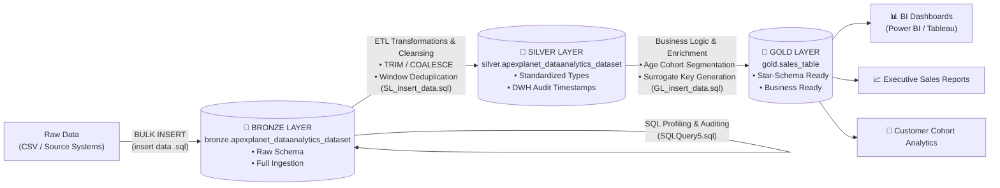

# 🪐 ApexPlanet — Enterprise Sales Analytics Data Warehouse

[](https://www.microsoft.com/en-us/sql-server)
[-blue?style=for-the-badge)](https://en.wikipedia.org/wiki/Databricks#Delta_Lake)
[](https://learn.microsoft.com/en-us/sql/t-sql/)
[](https://github.com/)
[](LICENSE)

An enterprise-grade **Modern Data Warehouse (DWH)** and **T-SQL ETL Pipeline** built on **Microsoft SQL Server**. This project implements the **Medallion Architecture (Bronze ➔ Silver ➔ Gold)** to transform raw retail sales data into clean, curated, and analytically rich data models ready for Business Intelligence (Power BI, Tableau) and executive decision-making.

---

## 📌 Table of Contents

- [📖 About the Project](#-about-the-project)
  - [Business Context](#-business-context)
  - [Problem Statement & Challenges](#-problem-statement--challenges)
  - [The Solution](#-the-solution)
  - [Core Objectives](#-core-objectives)
- [🏗️ Architecture & Data Pipeline](#️-architecture--data-pipeline)
- [📐 Medallion Layers Breakdown](#-medallion-layers-breakdown)
  - [1. Bronze Layer (Raw Ingestion)](#1-bronze-layer-raw-ingestion)
  - [2. Silver Layer (Cleaned & Curated)](#2-silver-layer-cleaned--curated)
  - [3. Gold Layer (Business Analytics & Star Schema)](#3-gold-layer-business-analytics--star-schema)
- [🔍 Data Profiling & Quality Framework](#-data-profiling--quality-framework)
- [👥 Customer Demographic Segmentation](#-customer-demographic-segmentation)
- [📂 Repository Structure](#-repository-structure)
- [🛠️ Step-by-Step Setup & Execution Guide](#️-step-by-step-setup--execution-guide)
- [📊 Sample Analytical Queries](#-sample-analytical-queries)
- [💡 Key Engineering Highlights](#-key-engineering-highlights)
- [🤝 Contributing & License](#-contributing--license)

---

## 📖 About the Project

### 🏢 Business Context
**ApexPlanet** is a multi-category e-commerce and retail enterprise operating across major Indian metropolitan cities (including Bengaluru, Mumbai, Delhi, Hyderabad, Kolkata, Pune, and Patna). The company sells across 5 key product verticals:
- 📱 **Electronics:** Laptops, Mobile phones
- 👗 **Fashion:** Shoes, Apparel
- 📚 **Education:** Books, Learning supplies
- 🛋️ **Furniture:** Ergonomic chairs, Home decor
- 🌾 **Grocery:** Essential staples (Rice, FMCG goods)

With thousands of transactions recorded every month, the leadership and analytics teams require accurate, real-time visibility into sales performance, customer purchasing habits, product demand, and regional market penetration.

---

### ⚠️ Problem Statement & Challenges
Prior to this project, sales and transaction data was stored in disparate, unstandardized CSV extracts exported directly from order-taking systems. This caused severe data quality and analytics bottlenecks:

1. **Dirty & Inconsistent Data:** Raw records contained leading/trailing whitespace, missing city values, and casing discrepancies that caused aggregations and queries to fail.
2. **Duplicate Transactions:** Order redundancy (multiple duplicate rows for the same `order_id`) caused revenue to be artificially inflated in executive reports.
3. **No Centralized Data Lineage:** Lack of staging layers meant analytical queries were run directly against raw files, making tracking data transformations and load timestamps impossible.
4. **Absence of Customer Segmentation:** Customers' ages were logged as raw integers without cohort groupings, preventing the marketing team from running targeted generational campaigns (e.g., Gen Z vs. Millennials).
5. **No Dimensional Data Model:** Lack of surrogate keys and star-schema principles hindered seamless integration with BI visualization tools like Power BI and Tableau.

---

### 💡 The Solution
To resolve these bottlenecks, this project constructs a **scalable, automated T-SQL Medallion Data Warehouse** inside Microsoft SQL Server:
- **Bronze Layer (Staging):** Ingests raw transactional exports untouched using high-speed `BULK INSERT`, maintaining a faithful audit trail of source data.
- **Silver Layer (Curated):** Applies rigorous data hygiene routines—stripping whitespace, imputing missing cities, filtering out duplicates via SQL window functions (`ROW_NUMBER()`), and appending warehouse audit timestamps (`dwh_create_date`).
- **Gold Layer (Analytics):** Flattens and enriches the data into a business-ready dimensional model featuring auto-incrementing surrogate keys (`table_id`) and dynamic customer demographic cohort categorization.

---

### 🎯 Core Objectives
- [x] **Zero Data Loss Ingestion:** Preserve raw transaction integrity in an immutable Bronze layer.
- [x] **Automated Data Quality Profiling:** Comprehensive auditing of NULL counts, duplicate keys, and categorical anomalies before transformation.
- [x] **Deterministic Deduplication:** Guarantee exactly one unique record per order using window functions.
- [x] **Customer Demographic Segmentation:** Automatically categorize buyers into five age cohorts (*Gen Z Adults*, *Millennials*, *Mid-Career*, *Mature Professionals*, and *Pre-Retirement*).
- [x] **BI & Dashboard Ready:** Deliver clean, high-performance tables optimized for Power BI, Tableau, and ad-hoc executive SQL querying.

---

## 🏗️ Architecture & Data Pipeline

The warehouse adheres to the **Medallion Architecture pattern**, establishing clear data lineage and data quality gates from ingestion to presentation:

<p align="center">
  
</p>

### 🔄 End-to-End Pipeline Workflow



---

## 📐 Medallion Layers Breakdown

### 1. Bronze Layer (Raw Ingestion)
- **Schema:** `bronze`
- **Table:** `bronze.apexplanet_dataanalytics_dataset`
- **Purpose:** Direct landing zone for source data ingested via T-SQL `BULK INSERT`. Preserves original formatting without destructive modification.
- **Attributes:** `order_id`, `order_date`, `customer_id`, `customer_name`, `age`, `gender`, `city`, `product`, `category`, `quantity`, `unit_price`, `total_sales`.

### 2. Silver Layer (Cleaned & Curated)
- **Schema:** `silver`
- **Table:** `silver.apexplanet_dataanalytics_dataset`
- **Purpose:** Clean, unified, and deduplicated single version of truth.
- **Transformations Applied:**
  - **Whitespace Cleansing:** `TRIM()` applied across `order_id`, `customer_id`, `customer_name`, `gender`, `product`, and `category`.
  - **Missing Value Handling:** Replaced `NULL` or empty city strings with standard `'N/A'` using `COALESCE(NULLIF(TRIM(city), ''), 'N/A')`.
  - **Deduplication:** Window function `ROW_NUMBER() OVER (PARTITION BY order_id ORDER BY order_date)` ensures each transaction is unique.
  - **Audit Metadata:** Appends `dwh_create_date DATETIME2 DEFAULT GETDATE()` for tracking load provenance.

### 3. Gold Layer (Business Analytics & Star Schema)
- **Schema:** `gold`
- **Table:** `gold.sales_table`
- **Purpose:** Consumption layer optimized for analytical queries, aggregation, and data visualization.
- **Enrichments Applied:**
  - **Surrogate Key:** Primary key `table_id INT IDENTITY(1,1)` for dimensional indexing.
  - **Optimized Data Types:** Scaled down `VARCHAR(255)` columns to strictly sized analytical storage (`VARCHAR(20)` to `VARCHAR(50)`).
  - **Demographic Classification:** Dynamic cohort classification (`age_category`).

---

## 🔍 Data Profiling & Quality Framework

Before moving data from Bronze to Silver, extensive quality verification is performed through [`SQLQuery5.sql`](./SQLQuery5.sql):

| Inspection Area | Description | Implementation Highlight |
|---|---|---|
| **Duplicate Detection** | Flags multi-order conflicts and recurring customer combinations | `GROUP BY customer_id, order_id HAVING COUNT(*) > 1` |
| **Complete NULL Audit** | Column-by-column scan across all 12 dataset attributes | Aggregated `SUM(CASE WHEN col IS NULL THEN 1 ELSE 0 END)` KPI matrix |
| **Categorical Integrity** | Evaluates distinct gender representations, casing, and category typos | `SELECT DISTINCT gender, category FROM bronze...` |
| **Consistency Testing** | Identifies if same `customer_id` has conflicting profile values | `HAVING COUNT(DISTINCT customer_name) > 1` |

---

## 👥 Customer Demographic Segmentation

The pipeline automatically categorizes buyers into marketing cohorts in the **Gold Layer**:

```sql
CASE
    WHEN age BETWEEN 18 AND 24 THEN 'Gen Z Adults'
    WHEN age BETWEEN 25 AND 34 THEN 'Millennials'
    WHEN age BETWEEN 35 AND 44 THEN 'Mid-Career'
    WHEN age BETWEEN 45 AND 54 THEN 'Mature Professionals'
    WHEN age BETWEEN 55 AND 65 THEN 'Pre-Retirement'
    ELSE 'Unknown'
END AS age_category
```

This segmentation enables instant cohort revenue breakdowns, product preference analysis by generation, and targeted marketing insights.

---

## 📂 Repository Structure

```plaintext
apexplanet/
│
├── 📁 assets/                      # Architectural diagrams & pipeline visualizations
│   ├── 🖼️ pipeline_flow.png        # Dark-mode Medallion pipeline diagram
│   └── 🎨 pipeline_flow.svg        # Scalable vector graphics architecture diagram
│
├── 📜 create database.sql          # Step 1: Database initialization and single-user drop safety check
├── 📜 create schema.sql            # Step 2: Creates bronze, silver, and gold schemas
│
├── 📜 create table.sql             # Step 3A: Bronze layer DDL table creation
├── 📜 insert data .sql             # Step 3B: Ingests raw CSV data using T-SQL BULK INSERT
│
├── 📜 SQLQuery5.sql                # Step 4A: Comprehensive data quality checks and NULL audits
├── 📜 createtable(silver).sql      # Step 4B: Silver layer validation and duplicate diagnostics
├── 📜 silver layer.sql             # Step 4C: Silver layer DDL table creation
├── 📜 SL_insert_data.sql           # Step 4D: Cleansing, TRIM, COALESCE & deduplication ETL
│
├── 📜 Gold_Layer.sql               # Step 5A: Gold layer analytical table DDL with identity primary key
├── 📜 GL_insert_data.sql           # Step 5B: Gold layer ETL loading with age cohort segmentation
│
├── 📜 calculation.sql              # Step 6: Analytical queries, category breakdowns, and aggregations
├── 📊 apexplanet_gothruchart.drawio# Architecture and ER diagram source (draw.io)
└── 📘 README.md                    # Project documentation
```

---

## 🛠️ Step-by-Step Setup & Execution Guide

Follow this sequence in **SQL Server Management Studio (SSMS)** or **Azure Data Studio**:

### 1️⃣ Database & Schema Initialization
Execute the setup scripts to prepare the clean environment:
```sql
-- 1. Create the database
:r "create database.sql"

-- 2. Create the Bronze, Silver, and Gold schemas
:r "create schema.sql"
```

### 2️⃣ Ingest Raw Data (Bronze)
```sql
-- 3. Create raw table
:r "create table.sql"

-- 4. Load CSV via BULK INSERT
-- (Ensure path in 'insert data .sql' points to your local dataset path)
:r "insert data .sql"
```

### 3️⃣ Audit & Transform (Silver)
```sql
-- 5. Run data quality profiling
:r "SQLQuery5.sql"

-- 6. Create Silver schema table & load cleaned records
:r "silver layer.sql"
:r "SL_insert_data.sql"
```

### 4️⃣ Model & Enrich (Gold)
```sql
-- 7. Create analytical Gold table & load enriched business data
:r "Gold_Layer.sql"
:r "GL_insert_data.sql"
```

---

## 📊 Sample Analytical Queries

Once the Gold layer is loaded, you can immediately run business intelligence queries:

### 🏆 Sales Performance by Product Category & Age Group
```sql
USE apexplanet;
GO

SELECT 
    category,
    age_category,
    COUNT(order_id) AS total_orders,
    SUM(quantity)   AS total_units_sold,
    ROUND(SUM(total_sales), 2) AS total_revenue
FROM gold.sales_table
GROUP BY category, age_category
ORDER BY category, total_revenue DESC;
```

### 🏙️ Top Revenue Cities by Gender Breakdown
```sql
USE apexplanet;
GO

SELECT 
    city,
    gender,
    COUNT(DISTINCT customer_id) AS unique_customers,
    ROUND(SUM(total_sales), 2)  AS total_sales
FROM gold.sales_table
WHERE city <> 'N/A'
GROUP BY city, gender
ORDER BY total_sales DESC;
```

### 📈 Customer Cohort Summary
```sql
USE apexplanet;
GO

SELECT 
    age_category,
    COUNT(DISTINCT customer_id) AS total_customers,
    ROUND(AVG(total_sales), 2)  AS avg_order_value,
    ROUND(SUM(total_sales), 2)  AS gross_sales
FROM gold.sales_table
GROUP BY age_category
ORDER BY gross_sales DESC;
```

---

## 💡 Key Engineering Highlights

- **Idempotency:** Every script safely checks for existing tables or schemas before recreation or uses `TRUNCATE TABLE` before reload to prevent dirty duplicates.
- **Defensive Data Handling:** String fields are trimmed against whitespace errors; invalid blanks are standardized with `COALESCE` and `NULLIF`.
- **Deduplication Strategy:** Utilizes deterministic ranking with `ROW_NUMBER() OVER (PARTITION BY order_id ORDER BY order_date)` to ensure exactly one record per order is retained.
- **Audit Lineage:** Ingestion timestamps (`dwh_create_date`) provide observability into data freshness across data warehouse layers.
- **Production-Ready Schema:** Transitioned from generic `VARCHAR(255)` types in Bronze to optimized, strongly typed schema definitions in Gold with identity surrogate keys.

---

## 🤝 Contributing & License

Contributions, issues, and feature requests are welcome! Feel free to open a pull request or issue to enhance ETL routines, add stored procedures, or include automated dbt / CI/CD scripts.

Distributed under the **MIT License**. See `LICENSE` for more information.
